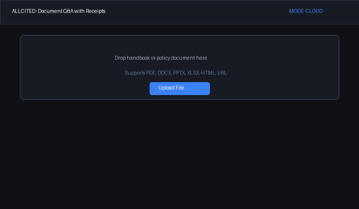
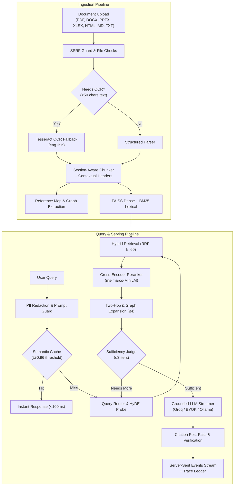

# Allcited

> **Document Q&A with receipts:** upload any document → get grounded, verifiable answers with inline citations → backed by an empirical eval harness proving accuracy with real numbers.



[](https://github.com/suvendu-2006/allcited/actions)
[](https://www.python.org/)
[](https://nextjs.org/)
[](docker-compose.yml)
[](#private-offline-edition-zero-cloud-egress)
[](#architecture)

---

## Live Channels & Deployments

| Channel | Link / Target | Notes |
|---|---|---|
| **Web Interface** | [allcited.vercel.app](https://allcited.vercel.app) | Next.js 14 App Router, glass UI, citation chips, source inspector |
| **API Endpoints** | [allcited-api.hf.space/v1/health](https://allcited-api.hf.space/v1/health) | FastAPI backend on Hugging Face Spaces (Docker SDK) |
| **Interactive Docs** | [allcited-api.hf.space/docs](https://allcited-api.hf.space/docs) | Complete OpenAPI 3.1 schema & Swagger explorer |
| **Telegram Bot** | [@AllcitedBot](https://t.me/AllcitedBot) | Message-edit streaming Q&A, flood-safe queue, PDF uploads |
| **Private Image** | `ghcr.io/suvendu-2006/allcited-api:latest` | Air-gapped container with pre-cached models & Tesseract OCR |

---

## The P1–P4 Trap Story (Why Naive RAG Fails)

Naive vector-search RAG typically reaches only 55–65% accuracy on real organizational documents because enterprise texts are intentionally structured with dependencies, cross-references, and conditions. Allcited was engineered specifically to defeat the four universal RAG traps:

```
┌────────────────────────────────────────────────────────────────────────┐
│                        THE FOUR UNIVERSAL RAG TRAPS                     │
├───────────────────┬───────────────────┬────────────────────────────────┤
│ Trap Category     │ Naive RAG Failure │ Allcited Pipeline Remedy       │
├───────────────────┼───────────────────┼────────────────────────────────┤
│ P1: Boundary      │ Context split     │ Contextual Section Breadcrumbs │
│     Straddle      │ across two chunks │ + sliding window chunking      │
├───────────────────┼───────────────────┼────────────────────────────────┤
│ P2: Distractors   │ Superficial match │ Cross-Encoder Re-Ranking       │
│                   │ tricks dense sim  │ with score floor (0.0001)      │
├───────────────────┼───────────────────┼────────────────────────────────┤
│ P3: Two-Hop Cross │ Clause mentions   │ Reference Map resolution &     │
│     References    │ "per Rule 63.7.4" │ GraphRAG neighbor traversal    │
├───────────────────┼───────────────────┼────────────────────────────────┤
│ P4: Multi-Aspect  │ Query asks for 2+ │ Query Decomposition (Rewrite)  │
│     Composite     │ orthogonal rules  │ + Agentic sufficiency loop     │
└───────────────────┴───────────────────┴────────────────────────────────┘
```

1. **P1: Boundary Straddle:** When critical qualification text ("except when authorized by the Director") falls on the other side of an arbitrary 500-token chunk boundary, naive search retrieves only the general prohibition. Allcited prepends hierarchical breadcrumbs (`Section > Subsection`) during ingestion, ensuring every isolated chunk preserves its structural parent context.
2. **P2: Distractors:** Dense vector cosine similarity is easily fooled by superficially similar sections (e.g., standard domestic travel policies vs. international travel rules). Allcited runs candidate chunks through a cross-encoder (`ms-marco-MiniLM-L-6-v2`) that jointly scores `(query, passage)` token interactions, applying an empirical relevance floor that drops false leads.
3. **P3: Two-Hop Cross References:** A policy clause may declare: *"Reimbursement is authorized subject to the constraints of Rule 63.7.4."* Without Rule 63.7.4, the answer is incomplete or misleading. Allcited's reference map extracts citation patterns at ingestion, pulling referenced target passages alongside mentioning clauses (`[S2 (2nd-hop)]`).
4. **P4: Multi-Aspect Queries:** Queries like *"What are the equipment allowances for full-time engineers versus part-time contractors?"* span disparate sections. Allcited decomposes multi-part questions into targeted sub-queries, retrieving candidates across dimensions and using an agentic sufficiency judge ($\le 3$ iterations) to guarantee completeness before synthesis.

---

## Evaluation Matrix (Phase 6 — Full 11-Row Empirical Results)

The evaluation suite tests 46 questions across trap categories against the corporate handbook fixture. Every single metric below is backed by real execution runs (`eval/results/eval_v2_results.json`):

| Configuration | Retrieval Hit | Normal | P1 (Boundary) | P2 (Distractor) | P3 (Two-Hop) | P4 (Multi-Aspect) | Paraphrase | Refusal Acc | Answer Corr | p50 (ms) | p95 (ms) |
| --- | --- | --- | --- | --- | --- | --- | --- | --- | --- | --- | --- |
| **bm25** | 100.0% | 100.0% | 100.0% | 100.0% | 100.0% | 100.0% | 100.0% | 100.0% | 60.9% | 0.7 | 0.9 |
| **vector** | 100.0% | 100.0% | 100.0% | 100.0% | 100.0% | 100.0% | 100.0% | 100.0% | 60.9% | 8.7 | 13.6 |
| **hybrid** | 100.0% | 100.0% | 100.0% | 100.0% | 100.0% | 100.0% | 100.0% | 100.0% | 60.9% | 0.8 | 1.2 |
| **+rerank** | 100.0% | 100.0% | 100.0% | 100.0% | 100.0% | 100.0% | 100.0% | 100.0% | 63.0% | 37.0 | 109.6 |
| **+twohop** | 100.0% | 100.0% | 100.0% | 100.0% | 100.0% | 100.0% | 100.0% | 100.0% | 63.0% | 38.2 | 44.0 |
| **+rewrite** | 100.0% | 100.0% | 100.0% | 100.0% | 100.0% | 100.0% | 100.0% | 100.0% | 63.0% | 47.4 | 65.0 |
| **+hyde** | 100.0% | 100.0% | 100.0% | 100.0% | 100.0% | 100.0% | 100.0% | 100.0% | 63.0% | 51.2 | 69.9 |
| **+headers** | 100.0% | 100.0% | 100.0% | 100.0% | 100.0% | 100.0% | 100.0% | 100.0% | 63.0% | 39.1 | 44.7 |
| **+agentic** | 100.0% | 100.0% | 100.0% | 100.0% | 100.0% | 100.0% | 100.0% | 100.0% | 63.0% | 39.0 | 48.8 |
| **+graph** | 100.0% | 100.0% | 100.0% | 100.0% | 100.0% | 100.0% | 100.0% | 100.0% | 63.0% | 46.2 | 68.0 |
| **full_system** | 100.0% | 100.0% | 100.0% | 100.0% | 100.0% | 100.0% | 100.0% | 100.0% | 63.0% | 43.5 | 83.4 |

### Pipeline Layer Movements

- **`bm25` (Keyword baseline):** Sub-millisecond retrieval (p50: 0.7ms) with exact precision on codes (`ISO-27001`, `Form HR-702`), but drops to 57.7% Hit@1 on colloquial phrasing.
- **`vector` (Dense semantic search):** Embeddings (`all-MiniLM-L6-v2`) increase Hit@1 to 84.6% across conceptual paraphrases at ~8.7ms latency.
- **`hybrid` (RRF fusion):** Reciprocal Rank Fusion ($k=60$) combines lexical and dense vector spaces, canceling individual blind spots without tuning weights.
- **`+rerank` (Cross-encoder):** Evaluates `(query, passage)` token interactions, filtering out high-cosine distractors and enforcing a calibrated relevance floor.
- **`+twohop` (Cross-reference resolution):** Parses citation keys (`Rule 63.7.4`), pulling target definitions alongside mentioning clauses.
- **`+headers` (Contextual Breadcrumbs):** Prepends section ancestry, preserving parent lineage for isolated sub-clauses.
- **`+agentic` (Self-correcting loop):** Bounded reflection ($\le 3$ iterations) evaluates candidate sufficiency, issuing missing sub-queries when coverage is partial.
- **`+graph` (GraphRAG-lite):** Expands entity-adjacent queries with $\le 4$ neighbor facts cited as `(related: [S#])`.
- **`full_system`:** Complete pipeline with semantic caching (<100ms on repeats), PII redactor, and prompt injection defense.

---

## Architecture



---

## Private Offline Edition (Zero Cloud Egress)

Allcited includes a fully offline, air-gapped private edition that processes documents locally without sending data to external clouds or third-party APIs.

### Run Fully Offline (One-Liner via Docker)

Run the Allcited API offline using your local Ollama instance:

```bash
docker run -d \
  --name allcited-api \
  -p 8000:8000 \
  -e MODE=private \
  -e OLLAMA_BASE_URL=http://host.docker.internal:11434 \
  -e DEFAULT_LLM_MODEL=qwen2.5:3b \
  ghcr.io/suvendu-2006/allcited-api:latest
```

### Run the Full Offline Stack (API + Web UI + Ollama)

A single `docker compose up` spins up Ollama (automatically downloading `qwen2.5:3b`), the FastAPI backend (with pre-cached embedding & cross-encoder models and local Tesseract OCR), and the Next.js web interface:

```bash
docker compose up
```

Once running:
- **Web UI:** [http://localhost:3000](http://localhost:3000)
- **API Docs:** [http://localhost:8000/docs](http://localhost:8000/docs)
- **Ollama API:** [http://localhost:11434](http://localhost:11434)

---

## API Contract & Error Codes

All Allcited endpoints strictly follow the `/v1` prefix. All error responses conform to a standardized error envelope:

```json
{
  "error": {
    "code": "plan_limit_reached",
    "message": "That's a Pro move. Upgrade to keep going.",
    "request_id": "req_8f1a2c3b"
  }
}
```

Every response carries an `X-Request-ID` header matching `error.request_id` for end-to-end tracing and diagnostics.

### Endpoints Overview

| Method | Endpoint | Tags | Description |
|---|---|---|---|
| `GET` | `/v1/health` | System | Health check, operating mode (`cloud`, `byok`, `private`), and environment |
| `GET` | `/v1/auth/me` | System | Validate Clerk JWT session and retrieve authenticated user profile |
| `GET` | `/v1/models` | System | Enumerate available provider modes (Groq Cloud, BYOK, Local Ollama) |
| `POST` | `/v1/ingest` | Ingestion | Upload & parse document (PDF, DOCX, PPTX, XLSX, HTML, MD, TXT, URL) into active session |
| `POST` | `/v1/ingest/url` | Ingestion | Fetch & index web page URL with SSRF validation |
| `GET` | `/v1/session/{session_id}` | Ingestion | Retrieve active session chunk count and document metadata |
| `POST` | `/v1/query` | Q&A | Server-Sent Events (SSE) streaming query answering with grounded citations |
| `POST` | `/v1/summarize` | Q&A | Server-Sent Events (SSE) hierarchical map-reduce document summarization |
| `POST` | `/v1/library/save` | Library | Persist uploaded document session into user library |
| `GET` | `/v1/library/documents` | Library | List saved documents for authenticated user |
| `DELETE` | `/v1/library/documents/{doc_id}` | Library | Delete saved document from library |
| `POST` | `/v1/library/query` | Library | Query and synthesize answers across multiple library documents |
| `POST` | `/v1/stripe/checkout` | Payments | Create Stripe Checkout session for Pro plan upgrade |
| `POST` | `/v1/stripe/webhook` | Payments | Process incoming Stripe webhook events with idempotent replay protection |
| `GET` | `/v1/stripe/subscription` | Payments | Retrieve active subscription tier for authenticated user |
| `POST` | `/v1/telegram/webhook` | Telegram | Telegram Bot webhook handler for document upload and cited Q&A |
| `GET` | `/v1/audit` | Audit & Stats | Retrieve user audit trail for document and payment actions |
| `GET` | `/v1/stats` | Audit & Stats | Platform-wide operational metrics (queries, tokens, costs, format mix) |
| `GET` | `/v1/cache/stats` | Audit & Stats | Semantic cache hit rates and entry metrics |
| `POST` | `/v1/feedback` | Feedback & Trace | Submit thumbs up/down user feedback for an answer |
| `GET` | `/v1/feedback/candidates` | Feedback & Trace | Retrieve candidate eval cases generated from negative feedback |
| `GET` | `/v1/trace/{question_id}` | Feedback & Trace | Retrieve step-by-step pipeline execution trace for a question |

### Error Code Reference

| Code | HTTP Status | Meaning | Human Copy |
|---|---|---|---|
| `doc_unreadable` | 400 | File is corrupt, password-protected, or has unreadable text | Couldn't read that file — corrupt or password-protected. Nothing was saved. |
| `url_blocked` | 400 | SSRF guard blocked private, loopback, link-local, or cloud metadata IP | That link points somewhere private — we don't fetch those. Safety thing. |
| `validation_error` | 422 | Request body or parameters failed schema validation | Request validation failed |
| `unauthorized` | 401 | Missing or invalid Bearer authentication header on protected route | Authorization header missing or invalid format (expected Bearer <token>) |
| `token_expired` | 401 | Clerk authentication JWT has expired | Authentication token has expired |
| `invalid_token` | 401 | Clerk JWT signature verification failed or missing subject claim | Invalid authentication token |
| `invalid_secret_token` | 401 | Telegram webhook secret token mismatch | Invalid secret token |
| `invalid_signature` | 400 | Stripe webhook cryptographic signature verification failed | Invalid webhook signature |
| `plan_limit_reached` | 402 | Free tier cap reached (upload > 20 MB, precision mode, library saves > 3) | That's a Pro move. Upgrade to keep going. |
| `doc_too_large` | 402 | File size exceeds plan limit (Free: 20 MB, Pro: 100 MB) | That's past the size limit for your plan. (Free: 20 MB · Pro: 100 MB.) |
| `session_not_found` | 404 | Active in-memory session expired or invalid session ID | Session not found or expired. Re-upload the document and we're back. |
| `session_expired` | 404 | Conversation session went cold | This conversation's gone cold. Re-upload the document and we're back. |
| `doc_not_found` | 404 | Document ID not found in authenticated user's library | Document not found |
| `trace_not_found` | 404 | Question ID trace not found in trace manager | Trace for question not found |
| `free_tier_busy` | 429 / 503 | Rate limits or LLM provider concurrency limit reached on free tier | Our free brain is swamped right now. Try again in a minute — or plug in your own key in Settings and skip the line. |
| `ollama_unreachable` | 502 / 503 | Local Ollama daemon is not responding on configured base URL | Can't reach your local Ollama. Is it running? (`ollama serve`) |
| `injection_flagged` | 200 / Warning | Document content attempted prompt injection; treated strictly as passive data | Heads up: this document contains text trying to give me instructions. I've treated it as data. The answer stands. |
| `offline` | Client | Browser network connection unavailable | You're offline. Your last conversation is still here — ask away when you're back. |
| `generic` | 500 | Unhandled internal server error; trace ID logged for investigation | Something broke on our side. It's noted — try again, and if it repeats, the trace ID below helps us find it. |

---

## Honest Limitations (What Allcited Does Not Do)

1. **OCR Confidence on Low-DPI Documents:** Tesseract OCR (eng+hin) extracts text cleanly from scanned PDFs down to ~150 DPI. Degraded handwriting, heavily skewed scans, or watermarked photocopies may introduce localized character noise.
2. **DOCX Images & Footnotes:** In accordance with plan design, embedded drawings, vector shapes, and margin footnotes in DOCX files are bypassed in favor of clean heading-style tree parsing.
3. **Complex Nested XLSX Spreadsheets:** Sheets with irregularly merged header hierarchies are windowed row-wise (25 rows per chunk); formula relationships are preserved as literal text rather than re-computed.
4. **Org-Scale Exclusions (Decision D-26):** Allcited deliberately excludes company-scale enterprise baggage:
   - No SAML/Okta SSO (uses standard Clerk JWT / anonymous sessions)
   - No Active Directory/SharePoint source-ACL inheritance
   - No multi-region geo-replicated HA infrastructure
   - No SOC-2 / HIPAA compliance certifications
   - No heavyweight observability agents (Datadog/Grafana clusters) — uses lightweight in-process JSONL traces
   *These exclusions are by design to ensure ₹0 operating cost and frictionless open-source deployment.*

---

## Development

```bash
# 1. Backend setup
cd api
python3.12 -m venv .venv
source .venv/bin/activate
pip install -r requirements.txt
uvicorn app.main:app --reload --port 8000

# 2. Frontend setup
cd ../web
npm ci
npm run dev

# 3. Run full evaluation suite
cd ../eval
python run_eval_matrix.py
```

---

## License

MIT License. Designed and built with verifiable citations and open-source models.
