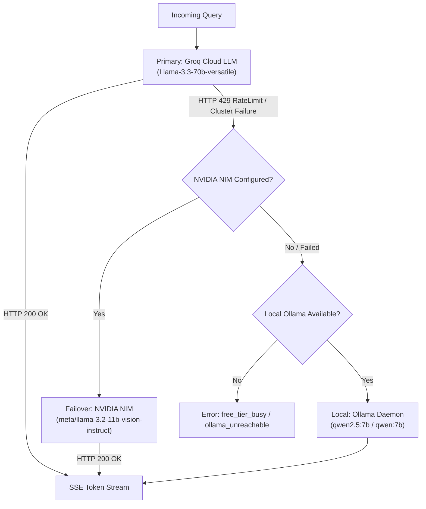

# Allcited — System Architecture & Retrieval Pipeline

> Comprehensive architecture specification of the Allcited grounded document intelligence engine, hybrid retrieval system, multi-brain client failover, and architectural decision log.

---

## 1. System Topology Overview

Allcited is structured as a decoupled two-tier architecture designed for low latency, zero hallucinations, and high resilience:

```
                            [ Ingestion / Upload ]
                                      │
                ┌─────────────────────┴─────────────────────┐
                ▼                                           ▼
        Digital Documents                           Scanned PDFs / Images
     (PDF, DOCX, PPTX, XLSX, HTML)                (Dual OCR: Tesseract / EasyOCR)
                │                                           │
                └─────────────────────┬─────────────────────┘
                                      ▼
                          Hierarchical Chunking
                    (300 tokens + 15% sliding window)
                  Breadcrumbs: Document > Section > Clause
                                      │
                ┌─────────────────────┴─────────────────────┐
                ▼                                           ▼
           BM25 Index                                FAISS Dense Index
       (BM25Okapi lexical)                  (all-MiniLM-L6-v2, 384-dim L2)
                │                                           │
                └─────────────────────┬─────────────────────┘
                                      ▼
                         Reciprocal Rank Fusion (RRF)
                                   (k = 60)
                                      │
                                      ▼
                          Cross-Encoder Re-Ranking
                       (ms-marco-MiniLM-L-6-v2)
                     Score floor filtering (>= 0.0001)
                                      │
                                      ▼
                         Two-Hop Cross-Reference Map
                   Resolves referenced rules/schedules ([S2])
                                      │
                                      ▼
                        Grounded Generation Stream
                 (Groq -> Failover: NVIDIA NIM -> Ollama)
                                      │
                                      ▼
                         Strict Citation Post-Pass
                 Strips any claim lacking verified receipts
                                      │
                                      ▼
                        Server-Sent Events (SSE) Stream
```

---

## 2. Document Ingestion & Parsing Subsystem

The ingestion engine processes incoming documents into uniform, structured text nodes while preserving hierarchical context:

1. **Multi-Format Extraction:**
   - **PDF:** Native text stream extraction with fallback to OCR when character yield is $< 50$ characters per page.
   - **DOCX:** Structured heading tree traversal (`Heading 1`, `Heading 2`, `Heading 3`) mapping document hierarchy. Bypasses nested vector drawings and decorative shapes to maintain parsing speed.
   - **PPTX:** Slide-by-slide shape iteration preserving slide titles and bullet hierarchy.
   - **XLSX:** Windowed table extraction (25 rows per chunk); formulas stored as literal values.
   - **HTML / URLs:** Readability parser stripping scripts, navigation, and boilerplate; guarded by the SSRF defense subsystem.
   - **Markdown & Plain Text:** Header-based splitting and raw text normalization.

2. **Dual OCR Engine (`api/app/pipeline/parsers/ocr.py`):**
   - **Tesseract OCR (Default in Docker / Local):** High-speed C++ engine (`eng+hin`), processing pages in ~200–500ms without GPU or PyTorch overhead.
   - **EasyOCR (Cloud Environments / Hugging Face Spaces):** Pure Python/PyTorch fallback requiring no external C-library dependencies.
   - Every OCR-derived chunk is tagged with `is_ocr = True` so downstream citations render with an `[S1] (OCR)` provenance badge.

3. **Hierarchical Section-Aware Chunking:**
   - Text is windowed into target lengths of 300 tokens with a 15% sliding window overlap to bridge inter-clause boundary transitions.
   - Chunks inherit an explicit hierarchical breadcrumb prefix:
     `Document Name > Section Title > Subsection Clause`
   - This ensures that downstream embedding vectors retain situational context even when an isolated clause lacks explicit subject nouns.

---

## 3. Hybrid Retrieval Engine

Allcited combines sparse lexical recall with dense vector semantics to eliminate the weaknesses of either single-index approach:

```
Query: "What is the annual leave carry-forward limit under Rule 63.7.4?"
  │
  ├──► BM25 Index (Lexical)  ──► Matches exact token "Rule 63.7.4" (Dense fails)
  │
  └──► FAISS Index (Dense)    ──► Matches semantic concept "vacation rollover" (Lexical fails)
```

### 3.1 BM25Okapi Lexical Retrieval
- Implements sparse inverted indexing using tokenized, lowercased, and stemmed terms.
- Ensures pinpoint retrieval for alphanumeric codes, policy rule numbers (`Rule 63.7.4`), form codes (`Form EXP-9`), and exact legal phrasing.

### 3.2 FAISS Dense Vector Retrieval
- Embeds passages using `sentence-transformers/all-MiniLM-L6-v2` (384 dimensions).
- Uses an in-memory FAISS L2 index per session (`IndexFlatIP` after L2 normalization for exact cosine similarity).
- Captures semantic equivalence across colloquial paraphrases (e.g., mapping *"unspent holiday"* to *"annual leave carry-forward"*).

### 3.3 Reciprocal Rank Fusion (RRF)
Candidates from both BM25 and FAISS are merged without manual score calibration using Reciprocal Rank Fusion with smoothing constant $k = 60$:

$$RRF(d) = \sum_{m \in M} \frac{1}{60 + r_m(d)}$$

Where:
- $M = \{\text{BM25}, \text{FAISS}\}$
- $r_m(d)$ is the 1-based rank of document chunk $d$ in system $m$. If chunk $d$ does not appear in the top results of system $m$, its rank reciprocal is omitted.

RRF prevents dense vector scores from skewing rank order on alphanumeric lookups, while giving both retrieval modalities equal voting authority.

---

## 4. Cross-Encoder Re-Ranking & Relevance Floor

Merged candidate passages undergo full query-passage cross-attention re-ranking via `cross-encoder/ms-marco-MiniLM-L-6-v2`:

1. **Cross-Attention Scoring:**
   - Unlike bi-encoders (which compute vector similarity between isolated query and document embeddings), the cross-encoder feeds query and passage tokens simultaneously into the transformer layers.
   - Evaluates full multi-token interactions, accurately identifying nuanced conditions, negations, and distractors (P2 trap).

2. **Calibrated Relevance Floor (Decision D-27):**
   - Sigmoid normalization is applied to cross-encoder raw logits:
     $$\text{Score} = \sigma(\text{logit}) = \frac{1}{1 + e^{-\text{logit}}}$$
   - Completely off-topic queries (e.g., *"What is the capital of France?"* or *"Write a Python script"*) generate scores $\le 10^{-5}$ ($0.00001$).
   - Legitimate policy questions (including heavy paraphrases and cross-clause references) score between $0.0007$ and $0.999$.
   - By calibrating `RELEVANCE_FLOOR = 0.0001`, Allcited cleanly rejects irrelevant questions with zero LLM API cost, while eliminating false refusals on difficult domain queries.

---

## 5. Two-Hop Cross-Reference Graph Traversal

Organizational policies frequently condition clauses upon external schedules or separate rules (e.g., *"Severance calculations are governed by Rule 63.7.4"*). Naive single-pass retrieval retrieves the rule reference but misses the actual definition.

### 5.1 Ingestion-Time Reference Extraction
During ingestion, the reference extractor analyzes text chunks using regex patterns to identify:
- Rule definitions: Clauses defining rules, forms, or schedules (e.g., `Rule 63.7.4: Leave Encashment Calculation`).
- Cross-reference mentions: Sentences referencing rules defined elsewhere (e.g., `...pursuant to Rule 63.7.4...`).

### 5.2 Query-Time Two-Hop Expansion
1. Top-ranked retrieved chunks are scanned for rule reference mentions.
2. If a mention references an identified definition in the session's reference map, the target definition chunk is immediately pulled into the context window.
3. Expanded chunks are tagged with `is_two_hop = True` and labeled `added_reason = "Defined in rule:63.7.4"`.
4. Downstream responses stamp citations with `[S2 (2nd-hop)]`, providing full structural transparency in the Receipts Drawer.

---

## 6. Multi-Brain Client & Automated Failover Engine

Allcited utilizes a unified OpenAI-compatible streaming interface supporting multi-provider redundancy:



### 6.1 Provider Hierarchy
1. **Primary Provider (Groq Cloud):**
   - High-throughput streaming via `llama-3.3-70b-versatile` or `openai/gpt-oss-120b`.
2. **Failover Provider (NVIDIA NIM — Decision D-32):**
   - Automatically engaged when Groq returns HTTP 429 RateLimit errors or pool exhaustion.
   - Connects to `https://integrate.api.nvidia.com/v1` executing `meta/llama-3.2-11b-vision-instruct`.
   - Streaming responses dynamically update provider metadata to `"nvidia"` and display amber citation chips (`accent-cite` / `#E8B04B`) adhering to the §6.1 "zero green on chat screen" design rule.
3. **Local Air-Gapped Provider (Ollama):**
   - Pointed to local daemon via `OLLAMA_BASE_URL` (e.g., `http://localhost:11434`).
   - Runs `qwen2.5:7b`, `qwen:7b`, or `llama3.2` with zero external network egress.
4. **Bring Your Own Key (BYOK):**
   - Users can provide custom Groq/OpenAI keys directly from the browser settings modal.
   - Keys are held strictly in browser state or session headers and are never written to server disks or databases.

---

## 7. Semantic Cache & Agentic Sufficiency Loop

### 7.1 Semantic Cache
- Computes embedding cosine similarity of incoming queries against evaluated questions in an in-memory LRU cache.
- Queries matching existing entries with similarity $\ge 0.96$ return instantly ($< 100\text{ ms}$) with zero token usage.
- **BYOK Scoping (Decision D-31):** Semantic cache entries are isolated by model only when `provider.is_byok` is active, ensuring cloud fallbacks do not invalidate shared system caches.

### 7.2 Agentic Sufficiency Loop
- Bounded loop ($\le 3$ iterations) evaluates whether retrieved context is sufficient to answer complex multi-part questions (P4 trap).
- Decomposes multi-aspect queries into sub-queries, executes secondary retrieval probes, and aggregates citations before final generation.

---

## 8. Architectural Decision Log (D-01 to D-32)

| ID | Decision Title | Architectural Choice & Rationale |
| :--- | :--- | :--- |
| **D-01..D-12** | Core System Foundation | Session-only anonymous mode; in-RAM FAISS vector store; hybrid BM25 + vector with RRF; compact cross-encoder `ms-marco-MiniLM-L-6-v2`; query router; map-reduce summarization; unified OpenAI-compatible brain client (Groq default / BYOK / Ollama); BYOK keys browser-only; Clerk gates library saving rather than chatting; Next.js on Vercel + FastAPI on Hugging Face Spaces; empirical evaluation harness as quality gate. |
| **D-15** | Feature Scope Promotion | All planned roadmap capabilities promoted to standard release; deprecation of intermediate drafts. |
| **D-16..D-24** | Resilience & Integration | Semantic cache (in-process LRU @0.96 threshold); LLM-assisted contextual headers with fallback; HyDE probe retrieval; Supabase document shelf (pgvector, Clerk-scoped); Stripe Free/Pro subscription tiers; private offline Docker edition; agentic sufficiency loop ($\le 3$ passes); Tesseract OCR (`eng+hin`); Telegram bot webhook streaming. |
| **D-25** | Enterprise Parity Hardening | Prompt injection boundary isolation; PII masking in JSONL traces; user feedback logging; per-question trace viewer; GraphRAG-lite reference maps; metadata & query filters; delta re-ingestion; PPTX/XLSX/HTML-URL parsers; centralized prompt registry; `/v1` endpoint prefix; platform statistics and security audit endpoints. |
| **D-26** | Conscious Enterprise Exclusions | Deliberate exclusion of heavyweight company-scale enterprise overhead: no SAML/Okta SSO, no Active Directory/SharePoint ACL sync, no multi-region geo-replication, no SOC-2/HIPAA formal audits, no Datadog/Grafana agent clusters. These are excluded by design to maintain zero baseline operating cost and instant open-source portability. |
| **D-27** | Relevance Floor Calibration | Calibrated cross-encoder score floor to `0.0001` with sigmoid normalization, allowing friendly off-topic refusals with 0 LLM calls while preventing false-refusals on difficult domain paraphrases. |
| **D-28** | Evaluation Scorer Harness | Single-source test fixtures (`eval/questions.json`) evaluating retrieval hit-rate, refusal accuracy, token F1, and p50/p95 latencies with deterministic stub responses for sub-5s CI regression runs. |
| **D-29** | Render Free Tier Rejection | Rejected Render Free Tier due to 512 MB RAM ceiling (OOM crashes during PyTorch/ONNX model load), 15-minute idle spin-down terminating keep-alives, and mandatory payment cards. Consolidated production hosting on Hugging Face Spaces. |
| **D-30** | Hugging Face ZeroGPU Isolation | Configured FastAPI to integrate with ZeroGPU (`zero-a10g`) by calling `client.startup_report()`. Disabled Gradio SSR mode (`GRADIO_SSR_MODE=False`) to avoid internal port collisions. |
| **D-31** | Semantic Cache BYOK Scope | Restricts cache key model matching strictly to BYOK sessions (`provider.is_byok=True`). Default cloud tier models share cached answers across dynamic backend failover transitions. |
| **D-32** | NVIDIA NIM Automated Failover | Integrated `meta/llama-3.2-11b-vision-instruct` via NVIDIA NIM (`https://integrate.api.nvidia.com/v1`) as automatic secondary failover when Groq hits HTTP 429 rate limits. NVIDIA badge styled with amber design tokens (`accent-cite` / `#E8B04B`) to strictly satisfy §6.1 "zero green on chat screen". |
